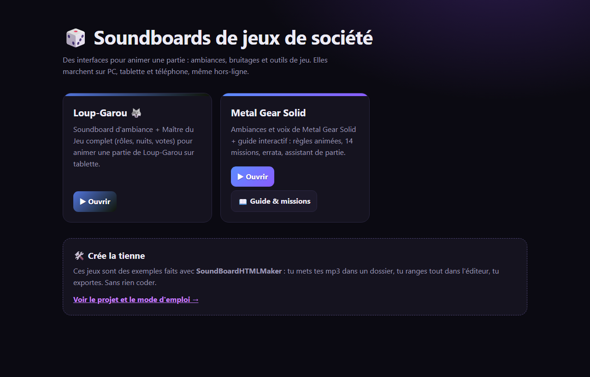
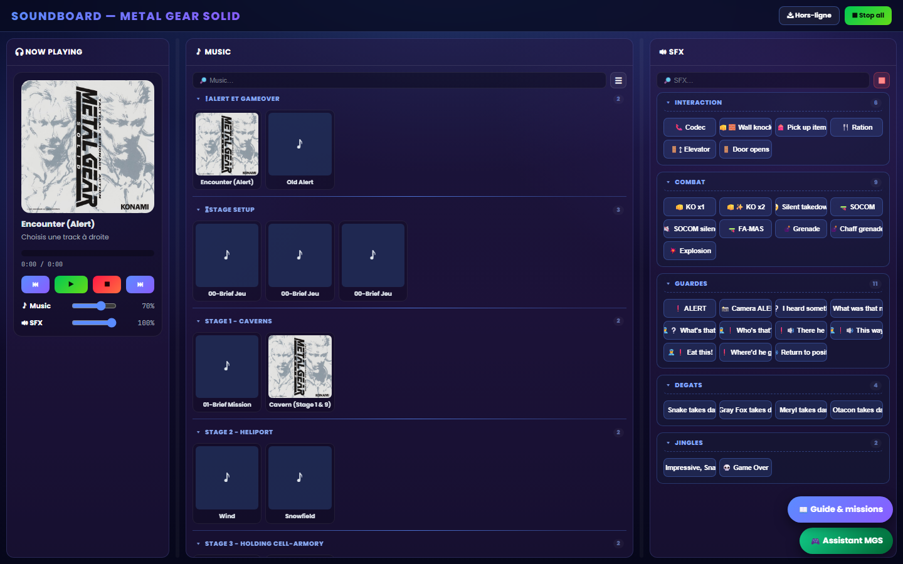
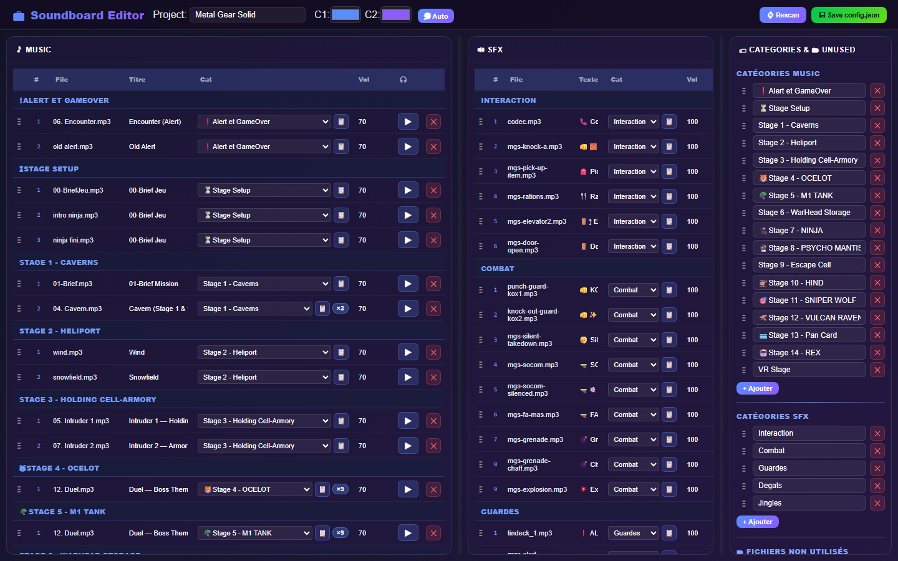
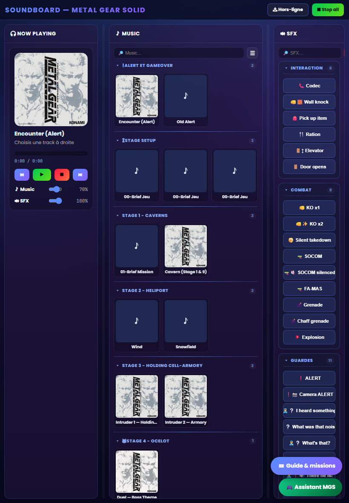
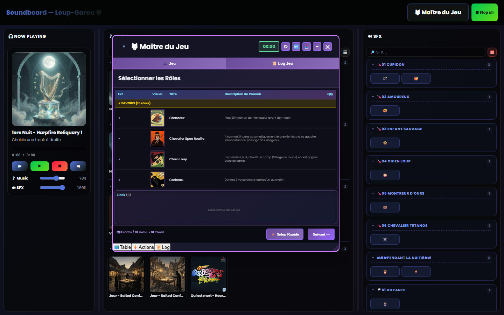
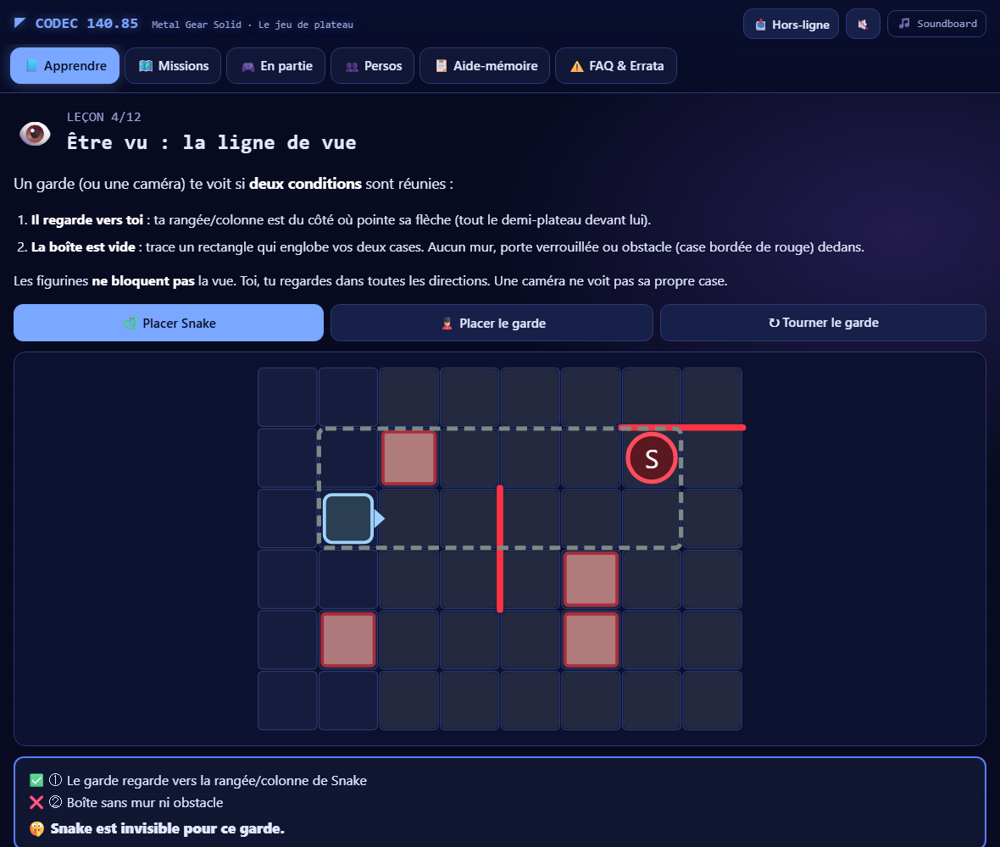
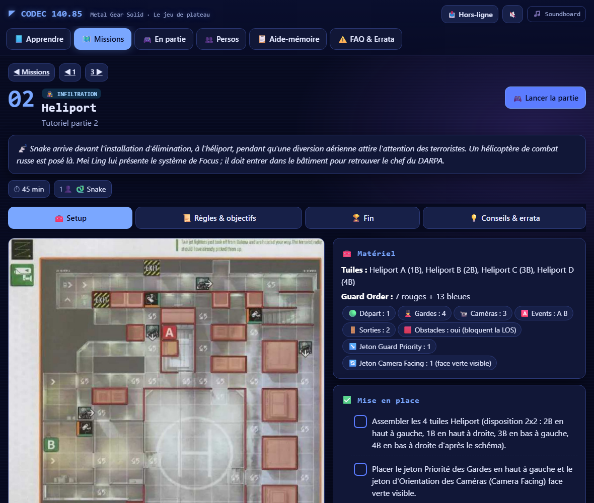

# 🎲 SoundBoardHTMLMaker

🇬🇧 [English version](README.en.md)

**Crée l'interface de ton jeu de société, sans coder.** Des ambiances, des bruitages, et si tu veux tes propres outils (règles, assistant de partie…). Le tout dans une page web qui marche sur PC, tablette et téléphone, même hors-ligne.

Tu poses tes mp3 dans un dossier, tu ranges tout dans l'éditeur, tu exportes. C'est tout.

👉 **Démo :** [soaresden.github.io/SoundBoardHTMLMaker](https://soaresden.github.io/SoundBoardHTMLMaker/)

L'interface existe en **français et en anglais** (bouton 🇫🇷 / 🇬🇧, ou automatiquement selon la langue du navigateur).



---

## ✨ Ce que tu obtiens

| Le player (sur tablette, PC ou téléphone) | L'éditeur (sur ton PC) |
|---|---|
|  |  |

- **Musiques d'ambiance** en boucle, rangées par catégories, avec pochettes (lues dans les tags des mp3).
- **Bruitages** en un clic, avec volume par son et volume général.
- **MP3 ou WAV** : un `.wav` déposé dans `music/` ou `sfx/` est converti automatiquement en `.mp3` au Scan et au Build. L'original reste sur ton PC et n'est jamais publié.
- **Un thème à tes couleurs** : 2 couleurs, ou extraites automatiquement d'une pochette.
- **Éditeur web** : glisser-déposer, catégories, titres, volumes, sans toucher au code.
- **Hors-ligne** : un bouton (ou le mode auto) met tous les sons en cache sur la tablette.
- **Deux formats d'export** :
  - **Light** : un `index.html` + les dossiers de sons. Idéal pour GitHub Pages.
  - **All-in-one** : un seul fichier HTML qui contient tout, à copier n'importe où.
- **Extensible** : chaque jeu peut ajouter ses propres boutons, pages et scripts. Voir les exemples.

---

## 🚀 Démarrage rapide (Windows)

**Il te faut :** [Python 3](https://www.python.org/downloads/), en cochant *« Add Python to PATH »* à l'installation.

1. Télécharge le projet (bouton vert **Code → Download ZIP**, ou `git clone`).
2. Double-clique sur **`runme.bat`**. Il installe ce qu'il faut et ouvre le menu.
3. Choisis **[7] Nouveau jeu** et donne-lui un nom (ex. *« Dixit chez Paul »*). Ça crée `games/dixit-chez-paul/`.
4. Mets tes musiques dans `music/` et tes bruitages dans `sfx/` de ce dossier.
5. **[1] Scan** pour lire tes mp3, puis **[2] Éditeur** pour ranger, renommer et colorer.
6. **[3] Build** : ton soundboard s'ouvre, prêt à jouer. Il est dans `FOLDERTOEXPORT/dixit-chez-paul/`.

> Pas sous Windows ? Tout passe aussi en ligne de commande (`python build.py …`, voir plus bas) et l'éditeur se lance avec `python server_static.py`.

---

## 📱 Le mettre sur ta tablette

**Le plus simple : GitHub Pages** (gratuit, une adresse web à ouvrir sur la tablette).

1. Fais un *fork* de ce dépôt (ou pousse le tien sur GitHub).
2. Sur GitHub : **Settings → Pages → Branch : `main` / `(root)`**.
3. Après un build et un `git push`, ton jeu est en ligne :
   `https://<ton-pseudo>.github.io/<dépôt>/FOLDERTOEXPORT/<ton-jeu>/`
   La page d'accueil `https://<ton-pseudo>.github.io/<dépôt>/` liste tous tes jeux.
4. Sur la tablette, ouvre la page puis appuie sur **📥 Hors-ligne** : tous les sons sont gardés et ça marche ensuite sans réseau. Astuce : « Ajouter à l'écran d'accueil ».

**Sans internet :** copie le dossier `FOLDERTOEXPORT/<ton-jeu>/` sur la tablette et ouvre `index.html`. Ou fais un build **All-in-one** ([4]) et copie juste `index_aio.html`.

<p align="center"></p>

---

## 🗂️ Comment c'est rangé

```
games/                      ← TES JEUX (les sources, c'est ici que tu travailles)
  _template/                ← le modèle copié par « Nouveau jeu »
  mon-jeu/
    config.json             ← sons, catégories, options (rempli par Scan + Éditeur)
    music/  sfx/            ← tes mp3
    covers/                 ← pochettes (extraites automatiquement au Scan)
    inject/                 ← (optionnel) HTML ajouté au player
    extras/                 ← (optionnel) fichiers copiés tels quels dans l'export
FOLDERTOEXPORT/mon-jeu/     ← GÉNÉRÉ par le build : à publier / copier, jamais à modifier
index.html                  ← page d'accueil générée (liste des jeux, pour GitHub Pages)
templates/                  ← le player, l'éditeur et le mode hors-ligne communs à tous les jeux
build.py · runme.bat        ← les outils
```

**La règle d'or :** on modifie `games/`, jamais `FOLDERTOEXPORT/`. Le build régénère l'export et ne supprime **que** les fichiers qu'il a lui-même créés : un dossier perso que tu ajoutes dans l'export (une appli Android, des PDF…) n'est jamais effacé.

### Options du jeu (`config.json` → `project`)

| Clé | Rôle | Exemple |
|---|---|---|
| `name` | Nom affiché | `"Loup-Garou 🐺"` |
| `themeColor`, `themeColor2` | Les 2 couleurs du thème (aussi réglables dans l'éditeur) | `"#5b8cff"`, `"#8a5cff"` |
| `description` / `description_en` | Texte sur la page d'accueil (français / anglais) | `"Ambiances pour…"` |
| `offline` | `"button"` = bouton 📥 Hors-ligne · `"auto"` = mise en cache automatique · absent = désactivé | `"button"` |
| `versionSwitch` | Affiche le bouton de bascule Light / All-in-one | `true` |
| `links` | Liens en plus sur la page d'accueil (`title`, `title_en`, `href`) | `[{"title": "📖 Règles", "href": "regles.html"}]` |

### Aller plus loin : `inject/` et `extras/`

Pour ajouter tes propres outils au player, sans toucher au template commun :

| Fichier | Où il est inséré |
|---|---|
| `inject/head-start.html` | dans `<head>`, avant les styles du player |
| `inject/head.html` | dans `<head>`, après les styles (pour les surcharger) |
| `inject/header.html` | boutons dans l'en-tête, à côté de « Stop all » |
| `inject/body.html` | juste avant `</body>` (tes scripts) |

Tout ce qui est dans `extras/` (scripts, images, pages HTML…) est copié tel quel dans l'export. Pour que ces fichiers soient aussi disponibles hors-ligne, déclare-les dans `inject/body.html` :

```html
<script> window.SB_OFFLINE_EXTRA_URLS = () => ["regles.html", "img/plateau.jpg"]; </script>
```

Tes scripts peuvent aussi **piloter le soundboard** :

```js
SB.playMusic("ambiance-nuit.mp3");   // lance une musique (dans music/)
SB.playSfx("porte.mp3");             // joue un bruitage (dans sfx/)
SB.stopMusic();  SB.stopAll();  SB.current();
```

---

## 🧩 Les exemples inclus

Ce sont mes propres jeux, à titre d'exemple. Garde-les pour voir comment c'est fait, ou supprime `games/loup-garou`, `games/metal-gear` et leurs dossiers d'export.

### 🐺 Loup-Garou : soundboard + Maître du Jeu complet
Ambiances jour/nuit, bruitages par rôle, et un **Maître du Jeu** branché par `inject/` + `extras/gamemaster/` : sélection des rôles, nuits guidées, votes, mode hors-ligne automatique.
[▶ Ouvrir](https://soaresden.github.io/SoundBoardHTMLMaker/FOLDERTOEXPORT/loup-garou/)



### 🐍 Metal Gear Solid : le jeu de plateau
Musiques et voix du jeu, plus tout ce qu'il faut pour jouer sans se tromper :
- **🎮 Assistant de partie**, en 4 onglets :
  - **Mise en place** : plan et checklist ;
  - **Le jeu** : règles et errata intégrés ;
  - **Partie** : déroulé guidé tour par tour, « c'est à toi de jouer », points d'action, phase ennemie pas à pas, bruits de pas, alerte et sons automatiques ;
  - **Sons** : les musiques et les voix de la mission.
- **❓ Aide animée** : 14 petites scènes où l'on voit les pions bouger (ligne de vue, bruit, alerte, caméras…), quasiment sans texte.
- **📖 Guide** : leçons interactives, les 14 missions de la campagne et la mission VR 60, la FAQ et l'errata v1.2.

[▶ Ouvrir](https://soaresden.github.io/SoundBoardHTMLMaker/FOLDERTOEXPORT/metal-gear/) · [📖 Guide](https://soaresden.github.io/SoundBoardHTMLMaker/FOLDERTOEXPORT/metal-gear/guide.html)

| Leçon : la ligne de vue | Fiche mission |
|---|---|
|  |  |

---

## ⌨️ Ligne de commande

```bash
python build.py list                 # liste les jeux (★ = jeu courant)
python build.py use metal-gear       # choisit le jeu courant
python build.py new "Mon jeu"        # crée games/mon-jeu/ depuis le modèle
python build.py scan [jeu]           # lit les mp3 -> config.json (tes réglages sont conservés)
python build.py build [jeu]          # export Light
python build.py portable [jeu]       # export All-in-one (un seul fichier)
python build.py all [jeu]            # les deux
python build.py build-all            # tous les jeux + page d'accueil
python server_static.py --game mon-jeu   # éditeur sur http://127.0.0.1:8765/editor
```

---

## ⚖️ Droits

Le code est sous licence [MIT](LICENSE). Les musiques, voix et visuels des exemples appartiennent à leurs ayants droit (Konami pour Metal Gear Solid…) et sont là uniquement pour illustrer un usage personnel à la table de jeu. Pour ton propre jeu, utilise des sons que tu as le droit de diffuser.
